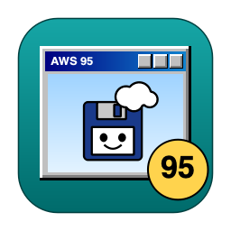
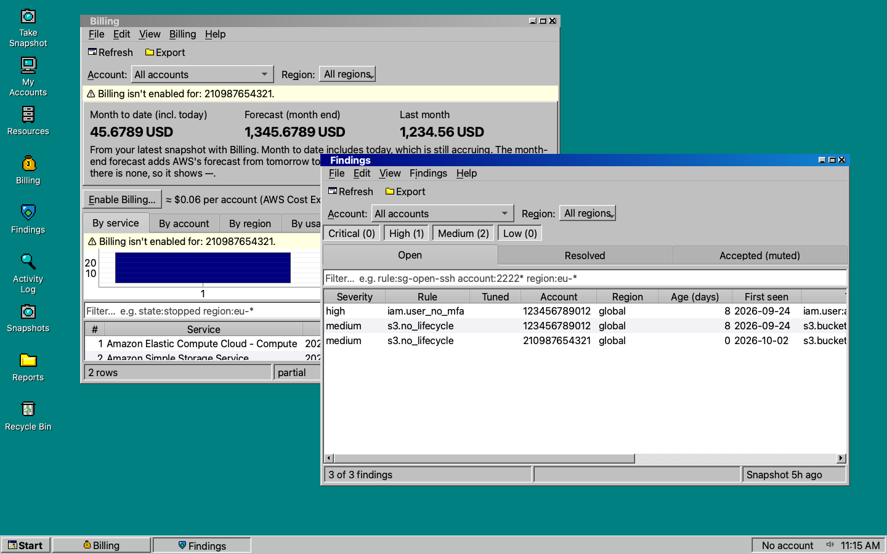
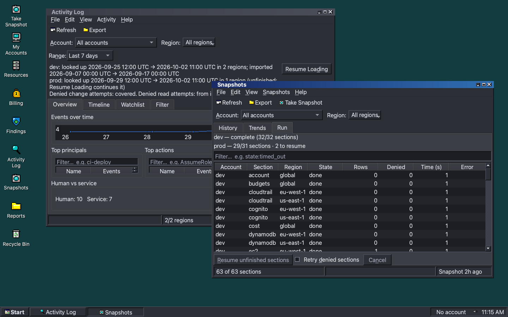
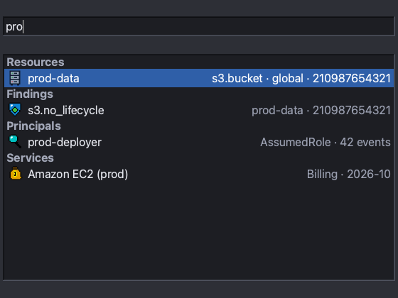
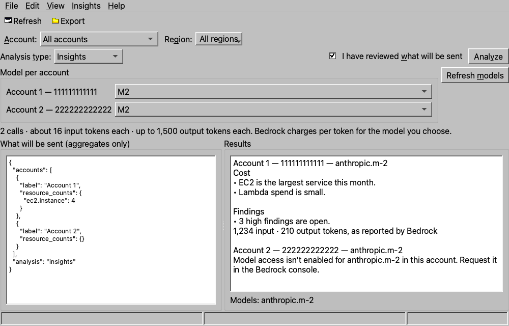
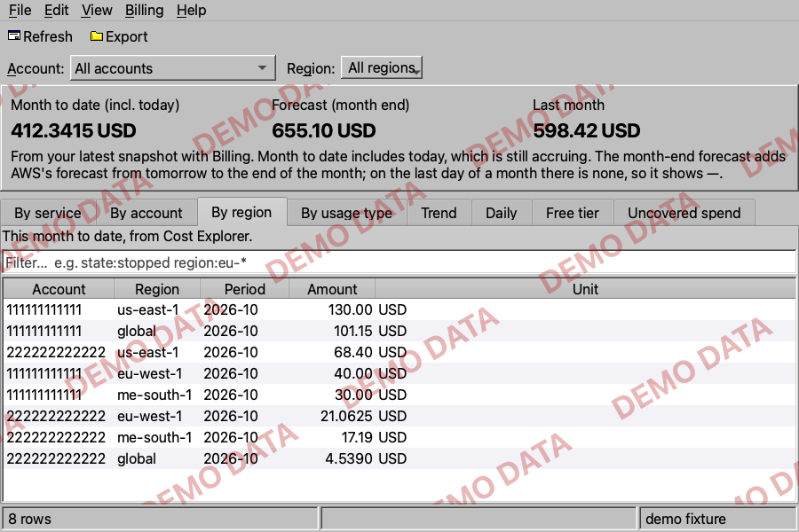
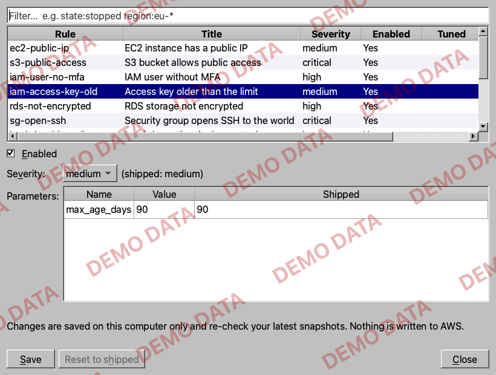
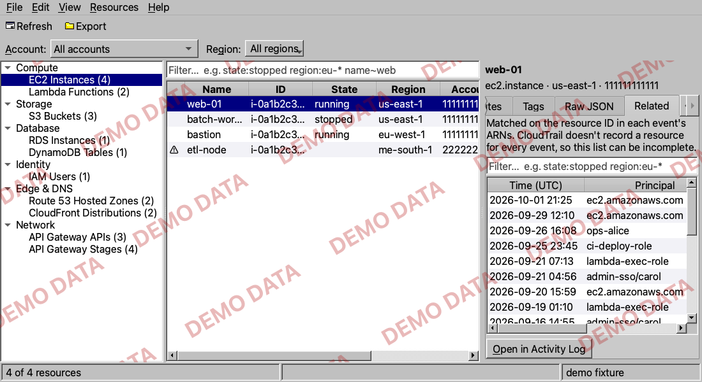
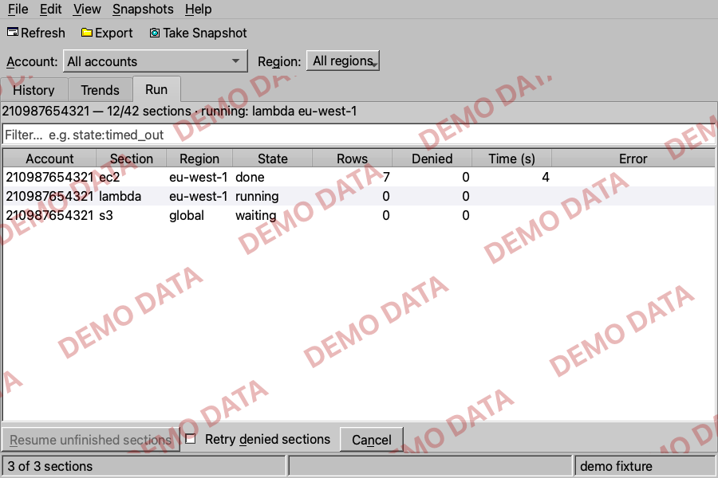
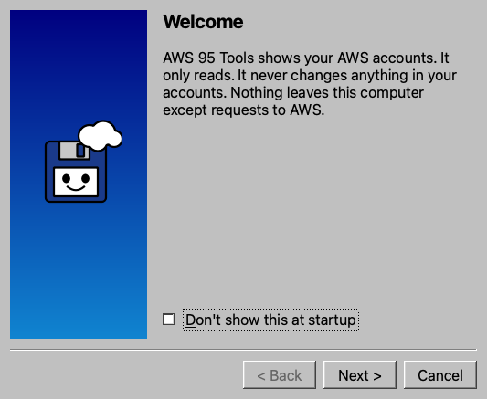

# AWS 95 Tools



A **read-only** desktop explorer for your AWS accounts, dressed as Windows 95. It has a desktop and taskbar, a Start menu, overlapping program windows, original sounds and screensavers, Light and Dark themes, and a font scale up to 150 %. It also has modern conveniences: a Ctrl+K command palette, window snapping, an Alt+\` window switcher and keyboard-first navigation.

Version 3.1.0 · MIT licence · macOS and Windows · Python 3.11–3.13 · PySide6 6.10





<details><summary>More screenshots</summary>

**Ctrl+K** finds programs, commands, and resources, findings, principals and services from your local data:



**AI Insights**: a model per account, a cost line, and one answer per account:



**Billing** by region, with the account each figure belongs to:



**Findings ▸ Rules…**: turn rules off, change severity and parameters, saved on your computer:



**Resources ▸ Related**: the stored CloudTrail events that name the selected resource:



**Snapshots ▸ Run** while a snapshot runs, section by section:



**Setup wizard**:



</details>

Screenshots use sample data with placeholder accounts. Windows showing demo data carry a "DEMO DATA" watermark, as they do in the app.

## The read-only promise

- AWS 95 Tools **only reads**. It never creates, changes or deletes anything in your AWS accounts.
- Every AWS call goes through one gate (`aws95/aws/gate.py`) that allows only a reviewed list of read operations, plus one named exception: AI Insights' Amazon Bedrock `Converse` call, made only when you press **Analyze**. It sends the aggregates you reviewed and writes nothing. The test suite fails if the code makes any other call.
- Opening a window never calls AWS. Only **Take Snapshot**, **Update activity**, **Import History…**, **Verify**, **Sign In**, and in AI Insights **Refresh models** and **Analyze** do.
- It never writes your `~/.aws` files. (When you use Sign In, the AWS CLI writes its own SSO cache.)

## What it shows

| Program | What it shows |
|---|---|
| **My Accounts** | Your profiles with nickname, colour and default regions; identity verification and permission checks; collector health from the latest snapshot; an "Include Billing in snapshots" choice per account |
| **Resources** | The resource types in each account's latest snapshot (compute, storage, databases, identity, security, networking, and edge and DNS: Route 53, API Gateway, CloudFront), with counts and rows per type. A region the snapshot didn't cover says "Not collected", never empty. The inspector's **Related** tab lists the stored CloudTrail events that name the selected resource |
| **Findings** | 44 built-in rules: open, resolved and accepted findings with first-seen and age. **Accept…** records a reason and an optional expiry. **Rules…** turns a rule off or changes its severity and parameters and re-checks your latest snapshots; **Seed finding…** records that a finding existed earlier; **Backfill…** re-runs today's rules over older snapshots. All of it is saved on your computer; nothing is written to AWS |
| **Fleet** | A rule × account matrix with a month-to-date cost row. Click a cell to jump to the matching findings |
| **Snapshots** | Snapshot history with collector health, a diff that never reports "not looked at" as "removed", and trends. A snapshot runs in sections (account × service × region), each saved as it finishes; the **Run** tab shows each account's progress, and **Resume** finishes only what didn't complete |
| **Billing** | Month-to-date, last month and the month-end forecast; spend by service, account, region and usage type; a 13-month or daily trend; free-tier usage; and **Uncovered spend**: services you pay for that no collector inventories. Amounts are exactly what AWS reports |
| **Activity Log** | Who did what, from CloudTrail. You choose how much history to load (7 days recommended); it loads in the background, newest first, and can resume. **Import History…** reads older events from your trail's S3 files |
| **AI Insights** | On **Analyze** only: per account, sends reviewed aggregate figures to an Anthropic model on Amazon Bedrock in that same account (see below) |
| **Reports** | Inventory, cost, open findings and activity watchlist from the local data, with what each report could not cover; saved as Markdown or CSV |
| **Display Properties**, **Screen Savers** | Background, theme, font scale, reduce motion, sounds and screensavers |

Every view says how old its data is and what it covered.

## What AI Insights sends

Nothing is sent until you tick "I have reviewed what will be sent" and press **Analyze**. Then, for each account in
view, exactly the preview you reviewed goes to the Anthropic model you picked, on Amazon Bedrock in that same account
and region:

- resource counts by type and the number of regions covered;
- open findings by severity and by rule name;
- month-to-date and last-month cost totals and the top 10 AWS services by cost;
- Activity event counts for 30 days, and risky events by rule.

Never sent: account ids, resource ids or names, ARNs, IP addresses, user or role names, tags, profile names or
nicknames. Accounts are labelled "Account 1", "Account 2". A preview that looks like it holds any of these is refused.
Answers are shown, not stored.

## Install from source

You need [uv](https://docs.astral.sh/uv/) and git.

```bash
git clone https://github.com/halalgami/awsTools95.git
cd awsTools95
uv sync
uv run python -m aws95            # the app, reading your AWS profiles
uv run python -m aws95 --demo     # sample data only, no AWS
uv run python -m aws95 --offline  # no AWS calls at all
```

On macOS you can also double-click `AWS95Tools.app` or `AWS95Tools.command` in the checkout. On Windows, use `AWS95Tools.bat`. `./run.sh` works too.

## Packaged build

Build a standalone app (no Python or uv needed to run it) on the OS you want it for:

```bash
uv sync
uv run python -m tools.build_nuitka
```

This produces `dist/AWS 95 Tools.app` on macOS, or `dist/AWS 95 Tools.dist/AWS 95 Tools.exe` on Windows. The build isn't signed or notarised yet, so macOS asks you to confirm the first launch (System Settings ▸ Privacy & Security ▸ Open Anyway). For details, see [docs/packaging.md](docs/packaging.md).

## First run

1. **Setup wizard.** It finds the profiles in `~/.aws/config` and `~/.aws/credentials`. You choose the ones to use. It then runs read-only permission checks for each one, lets you name the accounts, and finishes. Run it again any time from Start ▸ Settings ▸ AWS Setup Wizard….
2. **First snapshot.** The app offers to take one. It covers each account's default regions (or the profile's region plus `us-east-1`), plus global services. **Change regions…** lets you adjust that. Snapshots are always manual. When the newest one is more than a day old, the app asks again; it never runs one by itself.
3. **Activity.** Choose how much CloudTrail history to load: 7 days is recommended. 30 and 90 days show a time estimate before you start.

## IAM policy

Attach this policy to the role or user each profile uses. It is generated from the app's own permission table (`aws95/aws/permissions.py`). The first statement holds only read actions. The second is also read-only: API Gateway reads are authorised as `apigateway:GET` on the API paths, so they have their own statement, limited to those paths. The third, `bedrock:InvokeModel`, is limited to Anthropic models and is used only by AI Insights when you press **Analyze**; leave it out if you don't use AI Insights. If you prefer AWS-managed policies, `ViewOnlyAccess` covers most features and `SecurityAudit` covers the security checks.

<!-- BEGIN IAM POLICY: generated by `uv run python -m tools.make_readme_policy`; do not edit by hand -->
```json
{
  "Version": "2012-10-17",
  "Statement": [
    {
      "Sid": "AWS95ToolsReadOnly",
      "Effect": "Allow",
      "Action": [
        "access-analyzer:ListAnalyzers",
        "bedrock:ListFoundationModels",
        "budgets:ViewBudget",
        "ce:GetCostAndUsage",
        "ce:GetCostForecast",
        "ce:ListCostAllocationTags",
        "cloudfront:GetDistributionConfig",
        "cloudfront:ListDistributions",
        "cloudtrail:DescribeTrails",
        "cloudtrail:GetTrailStatus",
        "cloudtrail:LookupEvents",
        "cognito-idp:DescribeUserPool",
        "cognito-idp:DescribeUserPoolClient",
        "cognito-idp:ListUserPoolClients",
        "cognito-idp:ListUserPools",
        "dynamodb:DescribeContinuousBackups",
        "dynamodb:DescribeTable",
        "dynamodb:ListTables",
        "ec2:DescribeAddresses",
        "ec2:DescribeInstances",
        "ec2:DescribeNatGateways",
        "ec2:DescribeRegions",
        "ec2:DescribeSecurityGroups",
        "ec2:DescribeSnapshots",
        "ec2:DescribeVolumes",
        "ecr:DescribeRepositories",
        "ecr:GetLifecyclePolicy",
        "ecr:GetRepositoryPolicy",
        "ecs:DescribeClusters",
        "ecs:DescribeServices",
        "ecs:DescribeTaskDefinition",
        "ecs:ListClusters",
        "ecs:ListServices",
        "elasticloadbalancing:DescribeListeners",
        "elasticloadbalancing:DescribeLoadBalancers",
        "elasticloadbalancing:DescribeTargetGroups",
        "elasticloadbalancing:DescribeTargetHealth",
        "freetier:GetFreeTierUsage",
        "guardduty:ListDetectors",
        "iam:GetAccessKeyLastUsed",
        "iam:GetAccountPasswordPolicy",
        "iam:GetAccountSummary",
        "iam:ListAccessKeys",
        "iam:ListMFADevices",
        "iam:ListUsers",
        "kms:DescribeKey",
        "kms:GetKeyPolicy",
        "kms:GetKeyRotationStatus",
        "kms:ListAliases",
        "kms:ListKeys",
        "lambda:ListFunctions",
        "lambda:ListProvisionedConcurrencyConfigs",
        "logs:DescribeLogGroups",
        "rds:DescribeDBClusters",
        "rds:DescribeDBInstances",
        "route53:GetDNSSEC",
        "route53:ListHostedZones",
        "route53:ListQueryLoggingConfigs",
        "s3:GetBucketPolicyStatus",
        "s3:GetBucketPublicAccessBlock",
        "s3:GetEncryptionConfiguration",
        "s3:GetLifecycleConfiguration",
        "s3:ListAllMyBuckets",
        "secretsmanager:ListSecrets",
        "securityhub:DescribeHub",
        "sts:GetCallerIdentity"
      ],
      "Resource": "*"
    },
    {
      "Sid": "AWS95ToolsApiGatewayRead",
      "Effect": "Allow",
      "Action": [
        "apigateway:GET"
      ],
      "Resource": [
        "arn:aws:apigateway:*::/restapis",
        "arn:aws:apigateway:*::/restapis/*",
        "arn:aws:apigateway:*::/apis",
        "arn:aws:apigateway:*::/apis/*"
      ]
    },
    {
      "Sid": "AWS95ToolsInsightsInvoke",
      "Effect": "Allow",
      "Action": [
        "bedrock:InvokeModel"
      ],
      "Resource": [
        "arn:aws:bedrock:*::foundation-model/anthropic.*",
        "arn:aws:bedrock:*:*:inference-profile/*anthropic.*"
      ]
    }
  ]
}
```
<!-- END IAM POLICY -->

<!-- BEGIN BILLING NOTE: generated by `uv run python -m tools.make_readme_policy`; do not edit by hand -->
**Billing costs money.** Billing data comes from AWS Cost Explorer, which charges $0.01 per request. A snapshot with Billing enabled makes about 6 requests per account: ≈ $0.06 per account (AWS Cost Explorer charges). Billing is off until you turn it on for an account, and the Billing window never calls Cost Explorer itself; it shows what the last snapshot collected.
<!-- END BILLING NOTE -->

**Import History…** reads older events from your trail's log files in S3, so it needs a few more permissions, scoped to that trail's log folder (and its KMS key, if the logs are encrypted). An organisation trail also needs the read-only `organizations:DescribeOrganization`. The app shows the exact lines for your trail when it needs them. For a trail in the bucket `example-cloudtrail-bucket`, they look like this:

<!-- BEGIN IMPORT POLICY: generated by `uv run python -m tools.make_readme_policy`; do not edit by hand -->
```json
[
  {
    "Sid": "AWS95ListTrailLogs",
    "Effect": "Allow",
    "Action": "s3:ListBucket",
    "Resource": "arn:aws:s3:::example-cloudtrail-bucket",
    "Condition": {
      "StringLike": {
        "s3:prefix": [
          "AWSLogs/*"
        ]
      }
    }
  },
  {
    "Sid": "AWS95ReadTrailLogs",
    "Effect": "Allow",
    "Action": "s3:GetObject",
    "Resource": "arn:aws:s3:::example-cloudtrail-bucket/AWSLogs/*"
  },
  {
    "Sid": "AWS95DecryptTrailLogs",
    "Effect": "Allow",
    "Action": "kms:Decrypt",
    "Resource": "arn:aws:kms:us-east-1:123456789012:key/EXAMPLE"
  }
]
```
<!-- END IMPORT POLICY -->

## What costs money

Most of the app is free to run. A few actions make AWS requests that AWS bills to your account; each one says so, with this cost, before anything runs:

<!-- BEGIN COSTS: generated by `uv run python -m tools.make_readme_policy`; do not edit by hand -->
| Action | What AWS bills | About |
|---|---|---|
| Billing in snapshots (opt-in per account) | AWS Cost Explorer requests | ≈ $0.06 per account (AWS Cost Explorer charges) |
| The setup wizard's optional Billing access check | One AWS Cost Explorer request | AWS charges $0.01 per check |
| Import History… (Activity) | S3 requests and data transfer | Reads your CloudTrail log files from S3. AWS bills S3 requests and data transfer to your account (usually cents for a few days of logs; larger ranges cost more) |
| AI Insights (on Analyze) | Amazon Bedrock model calls | billed per token by the model you choose |

Everything else in the app is free to run: opening windows, snapshots without Billing, the CloudTrail lookups behind Activity, and the identity and permission checks make no billed requests.
<!-- END COSTS -->

## Privacy

- **Everything stays on your computer. AWS is the only network destination:** the app talks only to AWS APIs, with your own credentials. There is no telemetry. AI Insights sends only the anonymised figures you reviewed, to Amazon Bedrock in your own account (see "What AI Insights sends").
- Snapshots, findings and activity are kept in a local database (`aws95.db`). Treat it as sensitive, because it describes your accounts. It is never exported automatically, and **Settings ▸ Clear local data…** deletes it.
- Secret values that some AWS APIs return (Lambda environment variables, Cognito app-client secrets, ECS container environments), and the credentials and secrets inside CloudTrail events, are redacted before anything is stored.

## Demo mode

`uv run python -m aws95 --demo` fills every window with sample data. Every demo window carries a watermark and `[DEMO]` in its title. Demo mode never calls AWS and never writes your settings or the local database.

## Keyboard

| Keys | Action |
|---|---|
| Ctrl+K | Command palette: programs, windows, commands, and search across your local resources, findings, principals and services |
| Ctrl+Esc | Start menu |
| Alt+\` / Alt+Shift+\` | Switch windows |
| Ctrl+Alt+arrows | Snap the active window |
| F5 | Refresh |
| Ctrl+E | Export |
| Ctrl+W | Close window |
| Ctrl+Q | Shut Down… |
| F1 | About |
| Alt+letter | Menu and button mnemonics |
| Enter | Open the selected row |

## Contributing

Issues and pull requests are welcome.

```bash
uv run pytest -q                                              # headless; tests never touch the network or AWS
uv run pytest tests/test_screenshots.py --update-screenshots  # refresh visual goldens, then look at every PNG
uv run python -m tools.make_readme_policy                     # after changing aws95/aws/permissions.py
uv run python -m tools.publish_check                          # the leak check the test suite also runs
```

- The project rules (read-only gate, exact money, honest states, plain-text provider text, Qt lessons) are in [CLAUDE.md](CLAUDE.md). The design specs are in [docs/superpowers/specs/](docs/superpowers/specs/).
- Any new AWS call needs a reviewed, read-only `(service, operation)` pair in `aws95/aws/gate.py`. The one exception, AI Insights' Bedrock `Converse`, is validated request by request.
- Dark mode and large fonts matter: new screens get Light, Dark and Dark-150 % goldens.
- Never commit credentials, real account IDs or data from your accounts; use `123456789012`.

Report security problems privately: see [SECURITY.md](SECURITY.md).

## Artwork

All artwork is original and painted in code: the icon, the Cloudy mascot, the program icons, the sounds and the screensavers. There is no Microsoft or Amazon artwork. AWS 95 Tools is not affiliated with Microsoft or Amazon.

## Licence

MIT. See [LICENSE](LICENSE).
